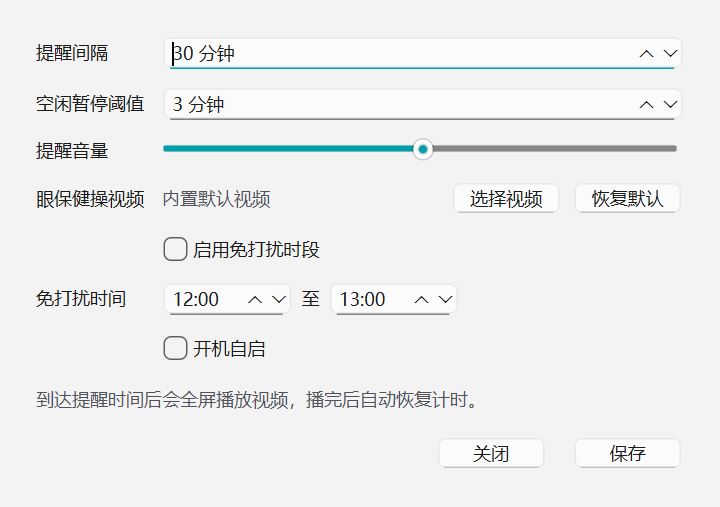
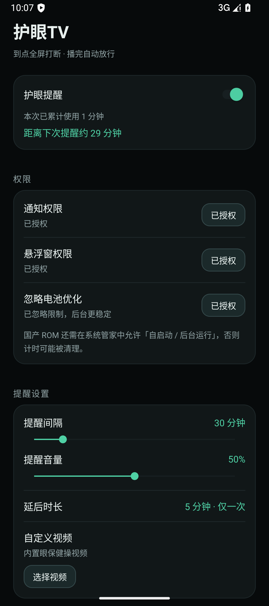
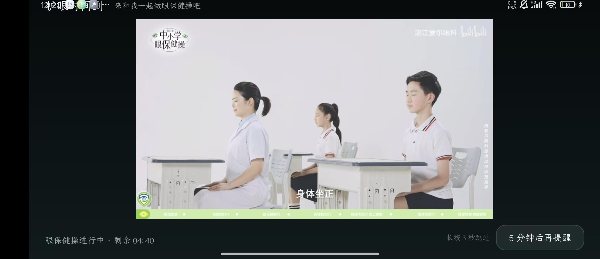
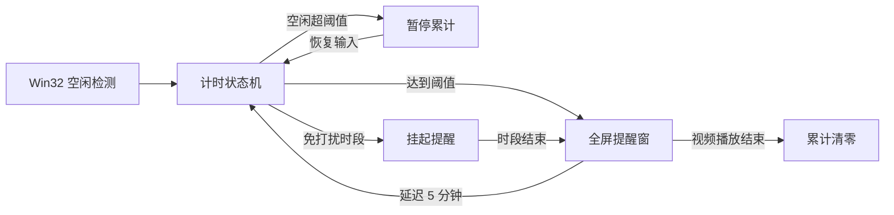

# 护眼TV · EyeCareTV

**到点就全屏打断你，播完眼保健操自动放行。**

一个 Windows / Android 双端护眼提醒工具：累计屏幕使用时长达到阈值后，自动全屏播放眼保健操视频，
播放结束再恢复使用。Windows 端基于 Python 与 PySide6，Android 端为 Kotlin 原生实现，
界面原生、无浏览器依赖、可离线运行。





## 为什么做这个

常见的护眼工具只弹一个通知，几秒后就被关掉，形同虚设。护眼TV 换了个思路：
把提醒做成一次**不可跳过的全屏播放**，用真实的眼保健操视频占住屏幕 5 分钟。
视频播完自动关闭并重新计时，不打扰正常工作节奏。

## 功能（Windows 客户端）

| 能力 | 说明 |
|---|---|
| 定时提醒 | 默认 30 分钟，可调 5–180 分钟 |
| 空闲暂停 | 连续 3 分钟无键盘鼠标输入自动暂停累计，回来继续 |
| 强制全屏 | 置顶无边框窗口播放视频，屏蔽 Esc 与 Alt+F4，播放期间阻止息屏 |
| 自动恢复 | 播完关闭窗口、累计清零，重新开始计时 |
| 失败兜底 | 视频无法播放时降级为 5 分钟闭眼倒计时，流程不会卡死 |
| 延迟一次 | 可推迟 5 分钟，第二次提醒不再提供该按钮 |
| 免打扰时段 | 时段内到点先挂起，时段结束立即补弹 |
| 托盘常驻 | 显示剩余时间，支持立即休息、暂停 30 分钟、开机自启、退出 |
| 单实例 | 重复启动时第二个进程自动退出，避免计时翻倍 |
| 自定义视频 | 设置页可选本地视频，自动复制到用户目录，不动内置素材 |

## Windows 快速开始

环境要求：Windows 10/11、Python 3.11 及以上。

```powershell
git clone https://github.com/tenderxiamu/eye-care-tv.git
cd eye-care-tv
python -m venv .venv
.venv\Scripts\python.exe -m pip install -r requirements.txt
.venv\Scripts\pythonw.exe main.py
```

也可以直接双击 `run.bat` 启动。

启动后程序驻留系统托盘，不会出现在任务栏。右键托盘图标可以打开设置。
想立刻看到效果，点托盘菜单里的「立即休息」。

## Android 客户端

同一套逻辑的 Kotlin 原生实现：前台服务累计亮屏使用时长，到点用悬浮窗全屏播放视频，
播完自动放行。只统计「亮屏且已解锁」的时间，息屏、锁屏自动暂停。

| 能力 | 说明 |
|---|---|
| 前台服务 | `FOREGROUND_SERVICE_SPECIAL_USE` 常驻计时，通知栏显示剩余时间 |
| 全屏悬浮窗 | `SYSTEM_ALERT_WINDOW` 覆盖在任意应用之上，播放期间保持屏幕常亮 |
| 权限引导 | 通知、悬浮窗、忽略电池优化三项逐项检测，未授权时说明影响 |
| 权限降级 | 没有悬浮窗权限时降级为高优先级通知 + 全屏提醒页 |
| 自动恢复 | 视频播完关闭悬浮窗，累计清零重新计时 |
| 失败兜底 | 视频缺失或解码失败时降级为 5 分钟闭眼倒计时 |
| 延迟一次 | 5 分钟后再提醒，第二次提醒不再提供该按钮 |
| 免打扰 | 时段内到点先挂起，时段结束立即补弹 |
| 开机自启 | 重启后自动恢复计时 |
| 自定义视频 | 从文件选择器挑视频，复制到应用私有目录，不动内置素材 |

<p>
  
  
</p>

### 构建

要求 JDK 17+ 与 Android SDK（compileSdk 36）。`android/local.properties` 保存本机 SDK 路径，
该文件不入库，需自行创建：

```properties
sdk.dir=C\:\\Android\\Sdk
```

```powershell
cd android
.\gradlew :app:assembleDebug
```

产物在 `android/app/build/outputs/apk/debug/app-debug.apk`，约 36 MB（其中内置视频 32 MB）。
内置视频直接复用 `app/resources/default_eye_exercise.mp4`，由 Gradle 在构建时拷贝进 `res/raw`，
Git 仓库里只存一份。

### 首次使用

1. 打开「护眼TV」，按设置页顺序授权：通知权限 → 悬浮窗权限 → 忽略电池优化
2. 国产 ROM 还需在系统管家中允许「自启动 / 后台运行」
3. 点「立即休息（预览提醒）」，可立刻查看全屏提醒效果

状态机与 Windows 端一致（`计时中 / 暂停 / 挂起 / 提醒 / 延后`），
见 [TimerEngine.kt](android/app/src/main/java/com/tenderxiamu/eyecaretv/TimerEngine.kt)，
纯 JVM 逻辑，可脱离 Android 框架做单元测试。

## 工作原理（Windows）



核心是 [timer_engine.py](app/core/timer_engine.py) 里的五状态机：
`计时中 / 暂停 / 挂起 / 提醒 / 延后`。UI 只负责呈现，所有判定逻辑集中在状态机中，
因此可以脱离界面直接做单元测试。

## 配置

配置保存在 `%APPDATA%\EyeCareTV\config.json`，首次启动自动生成。

| 字段 | 默认值 | 说明 |
|---|---|---|
| `remind_minutes` | 30 | 提醒间隔（分钟） |
| `idle_minutes` | 3 | 空闲暂停阈值（分钟） |
| `snooze_minutes` | 5 | 延迟时长（分钟） |
| `volume` | 50 | 提醒音量（0–100） |
| `video_path` | 空 | 自定义视频路径，空则使用内置视频 |
| `dnd_enabled` | false | 是否启用免打扰时段 |
| `dnd_start` / `dnd_end` | 12:00 / 13:00 | 免打扰起止时间，支持跨午夜 |
| `auto_start` | false | 是否开机自启 |

在设置页选择自定义视频后，文件会被复制到 `%APPDATA%\EyeCareTV\media\`，内置视频不受影响。

## 打包

```powershell
.venv\Scripts\python.exe -m PyInstaller --noconsole --onedir --name EyeCareTV --add-data "app/resources;app/resources" --clean --noconfirm main.py
```

产物在 `dist/EyeCareTV/`，约 159 MB。分发时拷贝整个文件夹，双击 `EyeCareTV.exe` 即用，
目标机器无需安装 Python。

## 测试

Windows：

```powershell
.venv\Scripts\python.exe -m unittest discover -s tests -v
```

覆盖五个场景：到点触发、空闲暂停与恢复、延迟一次、播放完成归零、免打扰挂起。
测试注入伪造时钟与空闲读数，不依赖真实等待。

Android：

```powershell
cd android
.\gradlew :app:testDebugUnitTest
```

覆盖六个场景，包括跨午夜免打扰。

## 项目结构

```
eye-care-tv/
├─ main.py                    入口：单实例、信号接线、事件循环
├─ app/
│  ├─ core/
│  │  ├─ idle_detector.py     Win32 键鼠空闲检测
│  │  ├─ timer_engine.py      计时状态机
│  │  ├─ dnd.py               免打扰时段判断
│  │  └─ autostart.py         开机自启注册
│  ├─ ui/
│  │  ├─ overlay.py           全屏提醒窗与视频播放
│  │  ├─ settings.py          设置页
│  │  └─ tray.py              托盘菜单
│  ├─ storage/config.py       配置读写
│  └─ resources/              内置眼保健操视频
├─ android/                   Android 客户端（Kotlin + Gradle）
│  └─ app/src/main/java/com/tenderxiamu/eyecaretv/
│     ├─ EyeCareService.kt    前台服务：计时、通知、悬浮窗调度
│     ├─ TimerEngine.kt       五状态机（纯 JVM，可单测）
│     ├─ ReminderView.kt      全屏提醒 UI 与视频播放
│     ├─ MainActivity.kt      权限引导与设置页
│     └─ BootReceiver.kt      开机自启
├─ tests/                     计时状态机单元测试
├─ tools/check_idle.py        空闲检测验证脚本
└─ requirements.txt
```

## Roadmap

- [x] Windows 客户端（计时、全屏提醒、视频播放、托盘、自启）
- [x] Android 客户端（前台服务 + 悬浮窗 + 通知降级）
- [ ] 单文件 exe 打包，进一步压缩体积
- [ ] 多显示器独立布局与镜像播放
- [ ] 静音模式与自定义提醒文案

## 贡献

欢迎提 Issue 和 PR。提交前请确保两端单测都通过：

```powershell
.venv\Scripts\python.exe -m unittest discover -s tests -v
cd android; .\gradlew :app:testDebugUnitTest
```

全部用例通过。

## 已知限制

- 无法拦截 `Ctrl+Alt+Del`、任务管理器或系统强杀，定位是强力提醒而非防沉迷
- 独占全屏游戏可能覆盖置顶窗口
- 挂机播放视频会被判定为空闲，不计入使用时长
- Android 上按 Home 键可暂时离开悬浮窗；部分国产 ROM 会清理前台服务，需手动加白名单
- Android 只累计「亮屏且解锁」的时间，息屏与锁屏期间不计时
- 若项目目录路径含中文等非 ASCII 字符，Gradle 单元测试 worker 可能报 ClassNotFoundException；
  把仓库放到纯英文路径即可（构建 APK 不受影响）

## License

[MIT](LICENSE) © 2026 tenderxiamu


